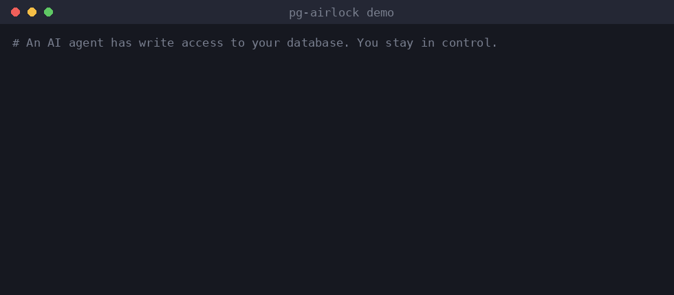

# pg-airlock

**Let AI agents write to your Postgres. You approve the exact diff.**

   



An MCP server that sits between an agent and a Postgres/Supabase database. The agent reads freely, but every write is executed inside a transaction that is **held open**. You see what the statement *actually did*, row by row, and then commit or roll back. The agent has no tool that can commit.

```
agent ──MCP (stdio)──▶  db_query    read-only transaction
                        db_execute  write runs in a HELD transaction → real diff → "pending"
                        db_status   pending / committed / rolled_back
                              │
                        [ Postgres transaction stays open ]
                              │
you ───CLI / local API──▶  pg-airlock pending | commit <id> | rollback <id>
```

## See it work

This is real output from `npm run demo` (an MCP client plays the agent, the CLI plays you; nothing is mocked). The agent meant to upgrade one customer and forgot the `WHERE`:

```text
--- 1. The agent means to upgrade ONE customer, but forgets the WHERE clause ---

agent> db_execute  UPDATE customers SET plan = 'pro'
  status: pending
  risk: high
  message: NOT applied yet.

you $ pg-airlock pending
  chg_4c0490e8a0  [PENDING]  risk: HIGH  rows affected: 4 (2 matched but already had these values)
  created 2026-10-16T17:01:39.997Z, auto-rollback at 2026-10-16T17:11:39.997Z
  
  SQL:
    UPDATE customers SET plan = 'pro'
  
  Changes:
    customers: 0 inserted, 2 updated, 0 deleted  [rows 4 -> 4]
      ~ id=2  plan: "free" -> "pro"
      ~ id=4  plan: "free" -> "pro"

you $ pg-airlock rollback chg_4c0490e8a0 --reason "missing WHERE"
  Rolled back chg_4c0490e8a0. The database is unchanged.

agent> db_status  chg_4c0490e8a0
  status: rolled_back
  message: NOT APPLIED: this change was rolled back (the human rejected it). The database does not contain it. Discard any assumptions or earlier reads that depended on it, re-read the current state, and adjust your plan before continuing.
```

The full run (the corrected retry, an agent trying to `COMMIT` its own change, the audit journal) is in [`docs/demo.txt`](docs/demo.txt).

## Why a held transaction

- **You review the real result, not a guess.** The statement really runs, so triggers, defaults, `RETURNING` and constraints are all reflected in the diff.
- **Rollback is exact and free.** It is a Postgres `ROLLBACK`. Postgres DDL is transactional, so even `DROP TABLE` can be previewed and undone.
- **The agent is told the truth.** A rejected change returns `NOT APPLIED ... discard any assumptions`, so it stops reasoning from a state that never became real.
- **No agent-side commit path.** The agent sees four tools: `db_schema`, `db_query`, `db_execute`, `db_status`. `COMMIT`, `ROLLBACK`, `BEGIN`, `SET`, `COPY`, `DO`/`CALL`, multi-statement strings, `EXPLAIN ANALYZE` (both spellings) and a deny-list of dangerous functions (file access, `pg_notify`, advisory locks, `pg_sleep`, `set_config`, ...) are rejected. Reads have a statement timeout (10 s by default) so a runaway query cannot block your approval.
- **Audit journal.** Every proposal and every human decision lands in `journal.jsonl`.

## Quick start

```bash
git clone <this repo> && cd pg-airlock
npm install && npm run build

# Try it with an embedded Postgres and sample data, nothing to set up:
node dist/cli.js serve --db memory --init examples/seed.sql

# Real Postgres or Supabase (use the direct connection string):
node dist/cli.js serve --db postgres://user:pw@host:5432/mydb
```

Add it to an MCP client. Claude Code:

```bash
claude mcp add pg-airlock -- node /abs/path/to/pg-airlock/dist/cli.js serve --db postgres://user:pw@host:5432/mydb
```

Any client that takes a JSON config (Cursor, Claude Desktop, ...):

```json
{
  "mcpServers": {
    "pg-airlock": {
      "command": "node",
      "args": ["/abs/path/to/pg-airlock/dist/cli.js", "serve", "--db", "postgres://user:pw@host:5432/mydb"]
    }
  }
}
```

Review from a second terminal (same `--state-dir`, default `~/.pg-airlock`):

```bash
pg-airlock pending                         # what is waiting, with the diff
pg-airlock commit   <id>                   # apply it
pg-airlock rollback <id> --reason "..."    # undo it
pg-airlock log                             # audit journal
```

## How it compares

These projects solve adjacent problems. Use them together if you need more than one.

| Project | Approach | Shows the real result before approval? | Scope |
|---|---|---|---|
| **pg-airlock** | Executes in a held transaction, human commits | **Yes**, row-level diff from the executed statement | Postgres / Supabase |
| [Revoco](https://pypi.org/project/revoco/) | Records an inverse plan per action, undoes later | No; arbitrary SQL is escalated to a human as "unknown" | Many systems via adapters (SaaS, cloud, files) |
| Policy gateways ([suvra](https://pypi.org/project/suvra/), [shugo](https://pypi.org/project/shugo/), [hoop.dev](https://github.com/hoophq/hoop)) | Classify/gate the statement, approve, audit | Approval is based on the statement and policy, as documented | MCP / SQL / shell |
| [Agent Rollback](https://mcpmarket.com/server/agent-rollback), [agent-undo](https://www.npmjs.com/package/agent-undo) | Snapshots of the workspace | n/a (files, not databases) | Project files |

## Risk levels

`high`: `UPDATE`/`DELETE` without `WHERE`, `DROP`, `TRUNCATE`, `GRANT`/`REVOKE`, 1000+ rows, unknown target tables, or a table too large for a row-level diff. `medium`: other DDL, several tables, 100+ rows. `low`: everything else.

## Known limitations (read before relying on it)

1. **Same-user trust.** The approval API token lives in `server.json` (mode 0600). An agent that runs as the same OS user and can read arbitrary files could find it and approve its own change. For real isolation run `serve` as a different user or in a separate container and expose only the MCP stdio to the agent. A unix-socket/peer-credential channel is the obvious next step.
2. **Open transactions hold locks.** While a change is pending, the rows it touched are locked for other writers (verified against Postgres 16). The default 10-minute TTL auto-rolls back; lower it with `--ttl` on busy databases. Poolers in transaction mode and `idle_in_transaction_session_timeout` can also end the transaction early, which simply rolls the change back.
3. **Database effects only.** Sequences (`nextval`), NOTIFY, triggers that call external services, `dblink`/FDW writes and anything outside the transaction are not undone. Triggers and cascading foreign keys can change tables the diff does not show; pg-airlock warns and raises the risk level when it sees them, but does not diff those tables. One pending change at a time.
4. **Classifier, not a parser.** `src/sql.ts` is conservative and tested against comment/literal/dollar-quote tricks, but it is not a full SQL parser. Reads additionally run in `BEGIN READ ONLY`, so Postgres is the second line of defence.
5. **Diffs read whole tables.** Row-level diffs snapshot each touched table (before and after) inside the transaction, so tables above `--max-rows` (default 5000) fall back to counts only. A production version should diff via `RETURNING`/triggers instead.
6. **Reads while pending see the pending change** (flagged with `pendingChangeId`). They run read-only inside the held transaction and are always rolled back to a savepoint, so a `SELECT` that calls a writing function cannot ride along with the change you approve.
7. **Embedded mode is for demos and tests.** PGlite accepts `statement_timeout` but does not enforce it, so a runaway read is only cut off on a real Postgres (covered by the real-Postgres test suite). Row-level security, roles and extensions behave as on the real server only when you connect to one.

## Development

```bash
npm test                                                   # typecheck + engine + end-to-end (embedded Postgres)
PG_AIRLOCK_TEST_PG=postgres://u@host/db npm test           # also run the real-Postgres suite
npm run demo                                               # the transcript above
```

## Roadmap

Compensation journal for undoing a change *after* commit (inverse SQL from the stored diff) · per-table policies and auto-approve for low risk · unix-socket approval channel · MySQL/SQLite · diffs via `RETURNING`/triggers for large tables.

Issues and PRs welcome. Security reports: see [SECURITY.md](SECURITY.md).

## License

MIT
